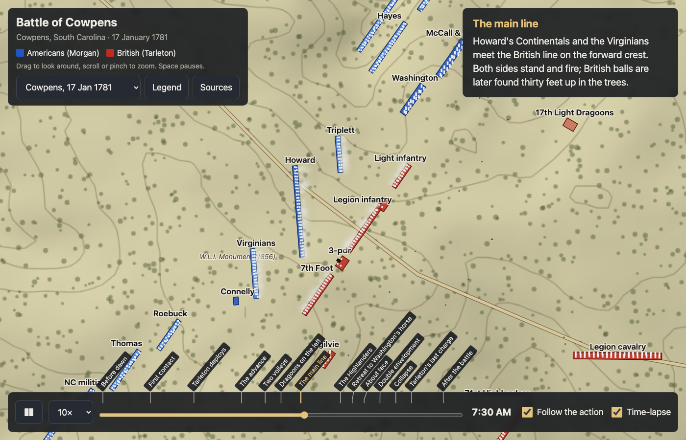
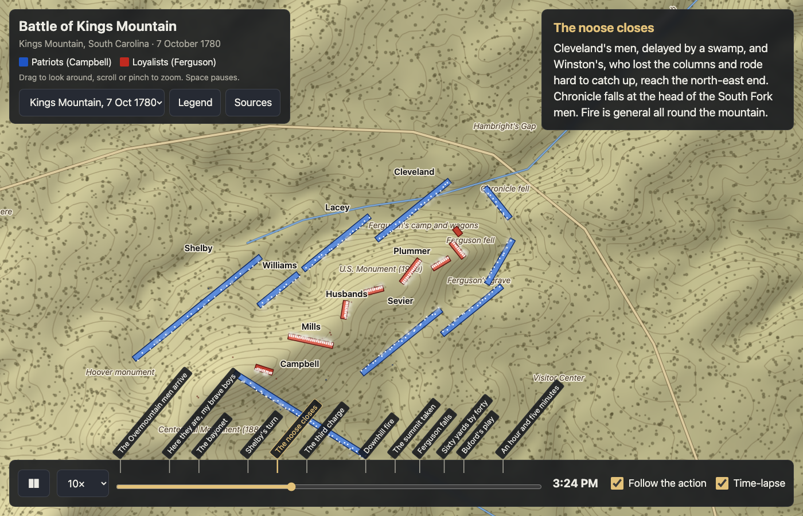
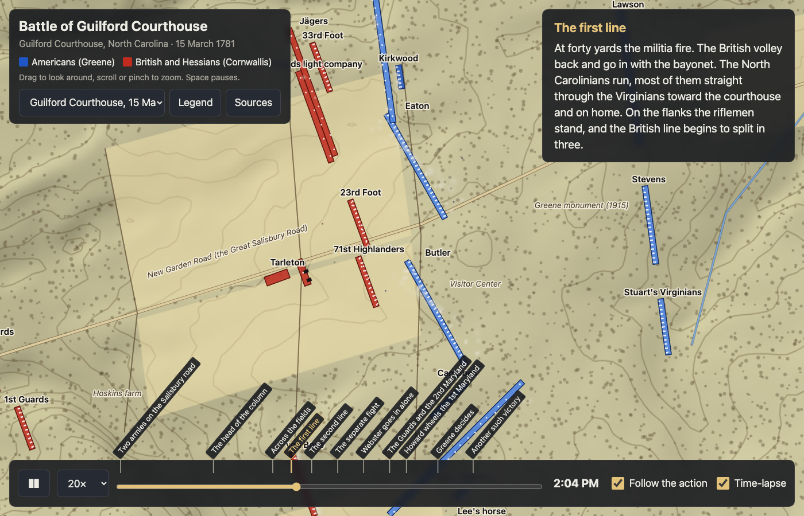
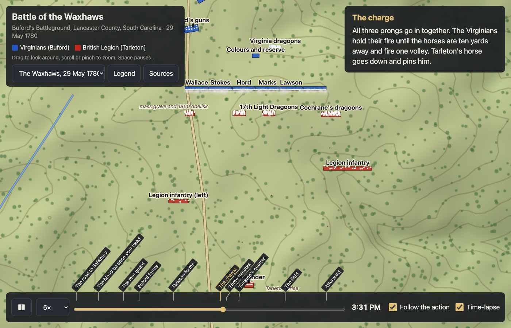
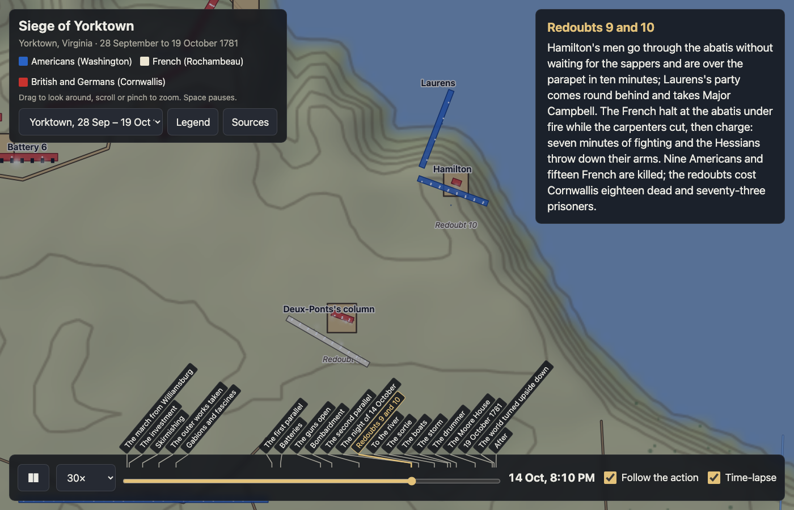

# Battlefield Replays

A browser app that replays historical battles from the written record. Regiment-sized units follow
keyframed timelines on real terrain; the viewer pans, zooms and scrubs time. Nothing is simulated
that would change the outcome. Built for a laptop with integrated graphics.







Battles so far: the Waxhaws (29 May 1780), Kings Mountain (7 October 1780), Cowpens (17 January 1781),
Guilford Courthouse (15 March 1781) and the siege of Yorktown (28 September to 19 October 1781).

## Run locally

```
npm run serve      # python3 -m http.server 8000
open http://localhost:8000/#cowpens
npm run check      # validates every battle and self-checks sim.js
```

On claw-mini the launch agent `com.vauseware.battle-sim` serves this folder on 127.0.0.1:8803 and
`tailscale serve --https=8803` proxies it, so the tailnet URL is https://claw-mini.tailcaa12e.ts.net:8803/.

Static files only. `index.html` is the shell, `app.js` draws, `sim.js` is the DOM-free timeline
logic. `#cowpens@07:45` opens a battle at a time of day (`#yorktown@1781-10-14T20:00` for a dated one);
`#cowpens@07:45,play` starts it playing. `,warp` pre-runs five seconds of frames, which is how headless
screenshots see smoke and the camera; `,legend` opens the legend.

The chapters sit above the scrubber as ticks, their titles slanting up over the map on leader lines
so crowded chapters can be spread apart: click one to jump there (the camera follows again). **Legend** in the
top panel lists only the symbols the current battle uses. Every unit carries its name when there is
room; labels that would overlap are dropped, biggest unit first.

**Time-lapse** (on by default, key `t`) hurries through stretches where nothing moves: the clock runs
at the battle's `lapse` rate until 90 seconds before the next movement, appearance or fight. A siege
bombardment does not count as movement, so Yorktown's days of gunnery pass in seconds.

## Add a battle

1. Add `battles/<id>/battle.json` and list it in `battles/index.json` with `id`, `name`, `date`
   (ISO) and `war`; the selector sorts by date and groups by war. Each existing battle is
   generated by its `make.py`, which is the easier way to author a timeline: edit it, run it, check.
2. Fetch terrain: `python3 tools/fetch_terrain.py LAT LON HALF_METRES COLS battles/<id>/terrain.json`.
   HALF_METRES must be half of `extent` in battle.json. US battlefields come from USGS 3DEP at 10 m.
3. `npm run check`.

### battle.json

Coordinates are metres from `origin` (the lat/lon at the map centre): x east, y north. Headings are
compass degrees. Times are the local clock, `HH:MM`, or `YYYY-MM-DD HH:MM` for a battle that runs more
than a day; one battle uses one form throughout.

| field | meaning |
|---|---|
| `extent` | map width and height in metres, centred on `origin` |
| `start`, `end`, `sunrise`, `sunset` | battle clock; the map is tinted before sunrise and, if `sunset` is given, every night |
| `speed`, `lapse` | default playback multiplier, and the multiplier for quiet stretches under time-lapse (default `speed × 6`) |
| `water` | elevation in metres at or below which the DEM is drawn as water (rivers are flattened to about 0) |
| `menPerDot` | men per drawn dot (5 for a small battle, 10 or 20 for a large one) |
| `sides` | `{ id: { name, color, light, dark } }` |
| `units[]` | `id, side, name, short?, commander, type, strength, guns?, loose?, ranks?, keys[]`; `short` is the map label; `loose` keeps a unit in open order; `ranks` defaults to 2 |
| `keys[]` | `{ t, x, y, h, state, strength }`; omitted fields carry forward from the previous key |
| `events[]` | `{ t, title, text, at: [x, y], view, speed }` captions; `at` and `view` (metres across) steer the auto-camera; `speed` sets the playback rate for that chapter while Follow is on (each chapter resets to the battle's `speed`) |
| `features[]` | `{ type: road|creek|fence|works|trench, name, pts }` lines, `{ type: redoubt|battery|ship|camp, poly }` polygons, or `{ name, at, rot }` labels; `from` and `until` show a feature only between those times, which is how siege lines get dug |
| `trees` | `density` in trees per square metre; `clear` is a list of polygons left bare, such as a summit |
| `fields` | polygons of cleared farmland, tinted lighter and kept free of trees |
| `sources[]` | shown in the Sources dialog |

Unit types: `infantry`, `light_infantry`, `militia`, `riflemen`, `cavalry`, `artillery`.
States: `hidden`, `column`, `line`, `skirmish`, `firing`, `charge`, `retreat`, `rout`, `surrender`.
A `firing` or `skirmish` state makes the unit smoke; a falling `strength` leaves casualty markers.
Positions between keys are straight-line interpolation, so add keys where a unit follows a road.
