# Field Glass

A browser app that replays historical battles from the written record. Regiment-sized units follow
keyframed timelines on real terrain; the viewer pans, zooms and scrubs time. Nothing is simulated
that would change the outcome. Built for a laptop with integrated graphics.

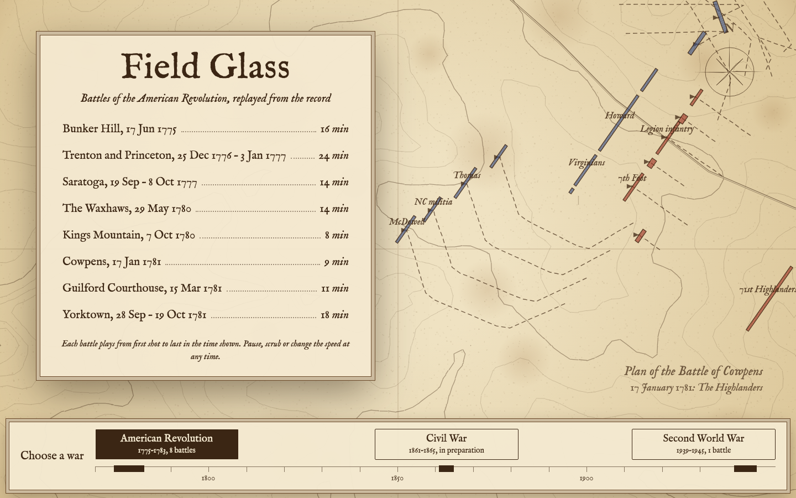

The start screen shows one war at a time, chosen on a timeline of the years along its foot. Each war's card
lists its battles with their running times over a backdrop in the dress of its maps: a Revolution battle, picked
at random, as a sepia plan; Sidi Bou Zid's recon mosaic under the operations-room lamp; New Orleans as a coastal
chart; and First Manassas's ground as an engineer's survey.
`npm run check` measures each running time by playing the battle through at the default settings (Follow and
Time-lapse on, chapter speeds honoured), writes it to `battles/index.json`, and fails if a battle's `war` has
no entry in `WARS` (`splash.js`). `#ww2` opens the start screen on a war (`revolution`, `war-of-1812`, `civil-war`, `ww1`, `ww2`); a
bare URL opens the Revolution. A link with a battle in it (`#cowpens`) skips the start screen, and All battles
returns to that battle's war. `?plan=yorktown` picks the Revolution's backdrop. See
[ADR-0005](docs/adr/0005-start-screen-per-war-timeline.md).

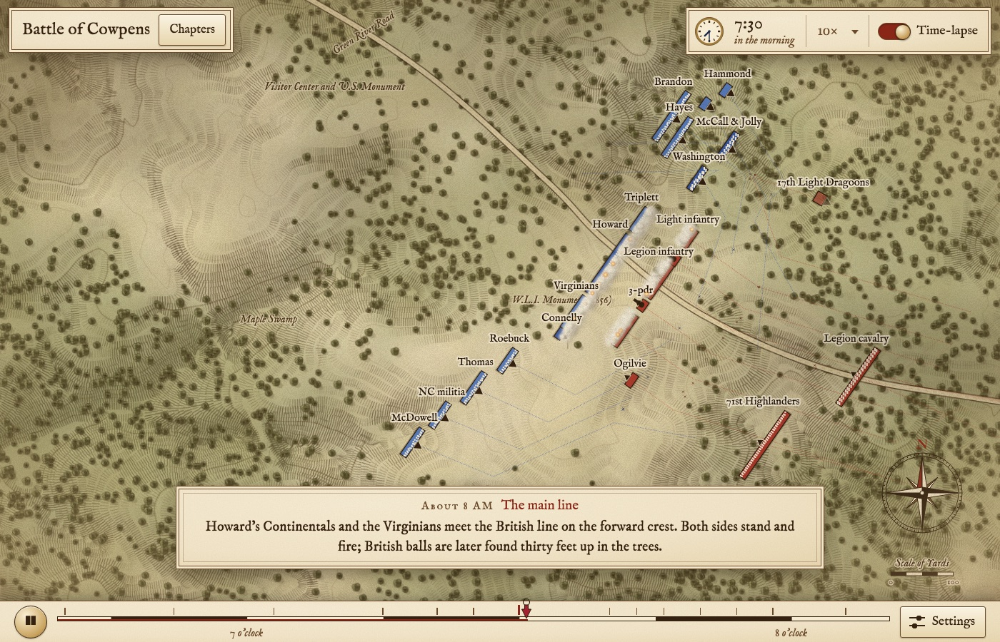
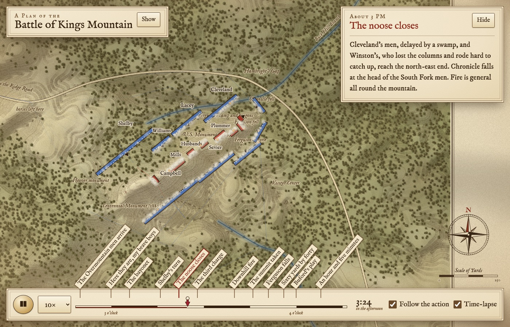
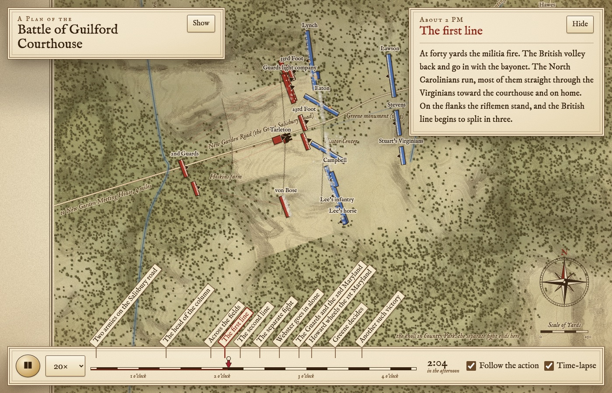
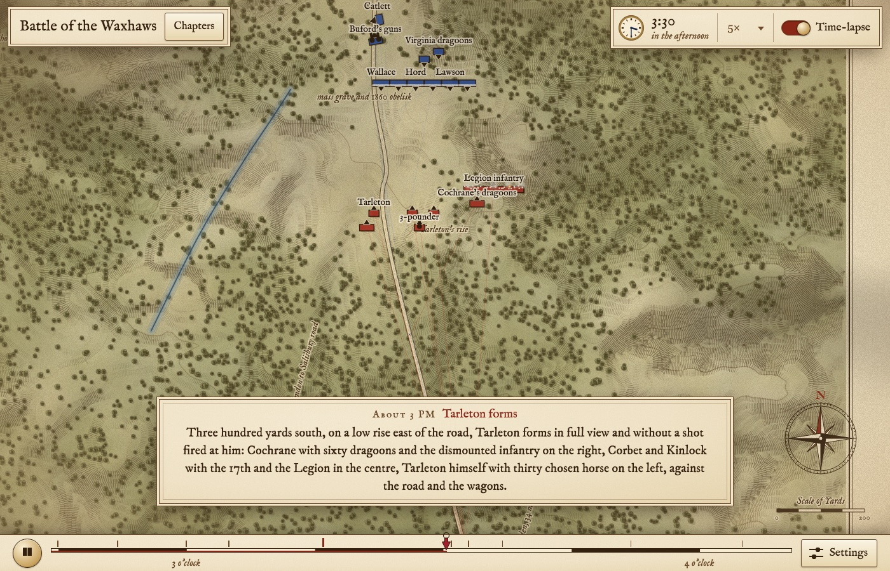
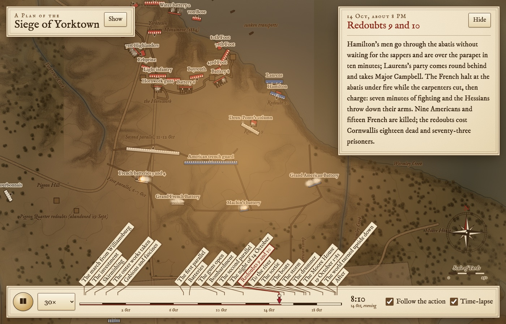
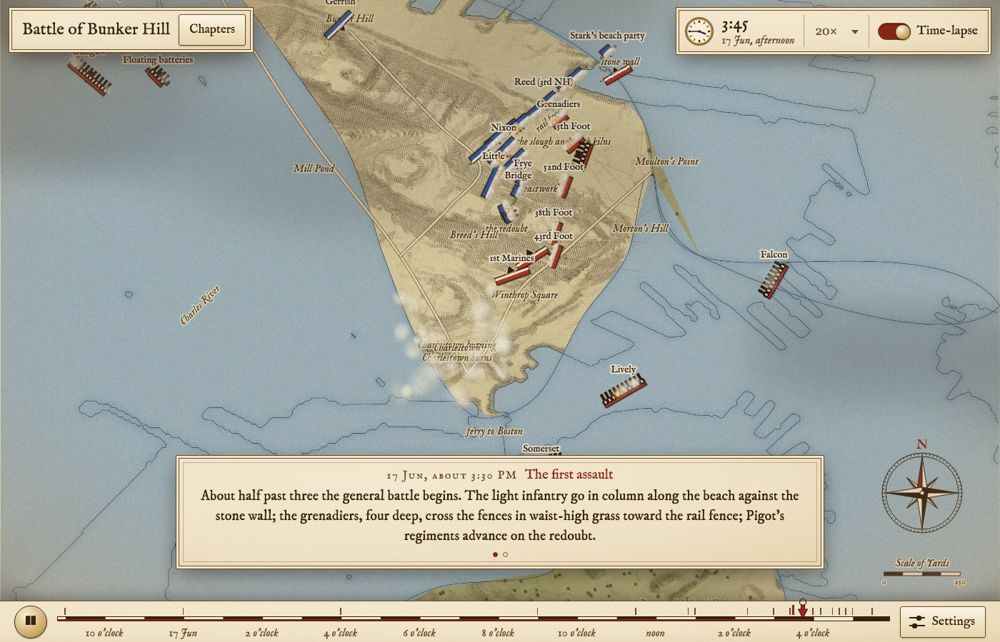
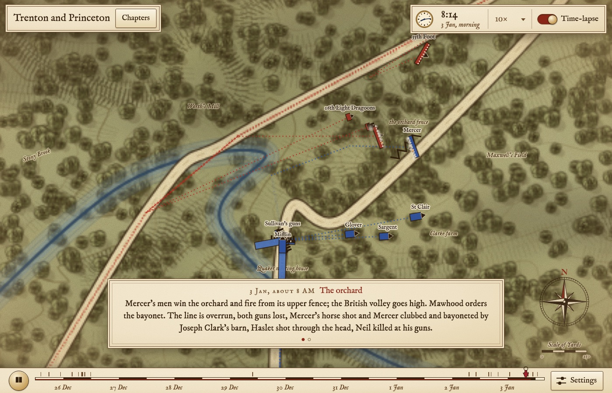

`battles/index.json` lists every battle, in date order; the start screen shows them by war.

## Run locally

```
npm run serve      # python3 -m http.server 8000
open http://localhost:8000/#cowpens
npm run check      # validates every battle and self-checks sim.js
```

[CONTRIBUTING.md](CONTRIBUTING.md) covers checking a change and sending a pull request.

## Deploy

`npm run deploy` copies the page, `app.js`, `sim.js`, `splash.js`, the skins and each battle's `battle.json` and `terrain.json`
into `dist/` (`tools/build.sh`) and uploads it as the Worker `fieldglass`, served at https://fieldglass.vause.io/.
The vause.io zone redirects only the bare domain and www to vauseware.com.

Static files only. `index.html` is the shell, `app.js` runs the camera, the clock and the panels, the skins in
`themes/` draw, `sim.js` is the DOM-free timeline logic. `#cowpens@07:45` opens a battle at a time of day
(`#yorktown@1781-10-14T20:00` for a dated one); `#cowpens@07:45,play` starts it playing. `,warp` pre-runs five
seconds of frames, which is how headless screenshots see smoke and the camera; `,warp,title` also holds the chapter
title on screen; `,select=howard` opens a unit's card; `,legend` opens the legend.

A battle started from its beginning opens like a television programme: the whole map with every unit in place and
no panels, the battle's name over its date fading in and out, then a four-second ease in to the frame Follow the
action gives the first chapter. The panels fade back as the camera settles, and only then does the clock start.
It runs once per load, from the start screen or on the first Play of a bare link such as `#cowpens`. A link with a
time or a flag, Play after a seek, and a replay go straight to the battle, and any click, key, scroll or drag cuts to
the landing. A battle that opens before sunrise keeps its night wash at dawn under the title. Under reduced motion
the title holds still and the camera cuts. Each skin dresses the title. `,opening` on a link holds the opening at
its title, for screenshots. See [ADR-0009](docs/adr/0009-opening-shot.md).

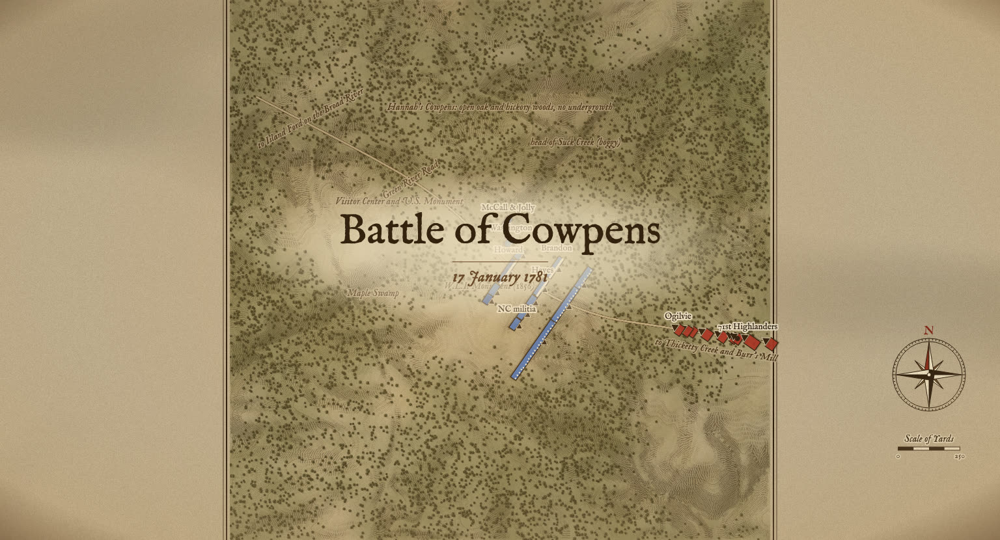

The chrome keeps to the edges of the map (see [ADR-0014](docs/adr/0014-battle-chrome-lower-third.md)). The bar docks
to the foot: Play, the scrubber and **Settings**. A tick above the groove marks each chapter, the current one taller in
the skin's accent, and the pointer on the scrubber names the nearest chapter and its time in a tip just above the bar;
a click still seeks. The battle's title sits in a chip at the top left. Its **Chapters** button opens a drawer down the
left edge with the place and date, the sides, **Outcome** (the result and each side's losses, `outcome` in `make.py`),
the chapter list, the hint line, and **All battles**, **Legend** and **Sources**. The list gives each chapter's time of
day and name, under day headings for a battle of more than one day; a click jumps there and turns Follow back on, and
the current row opens to its whole story. **Close**, Esc and Play close the drawer. A bare or `@time` link opens with it
open, `,play` with it shut, and `,outcome` opens it on the Outcome. **Legend** lists only the symbols the battle uses.

The story is a caption strip centred above the bar: the chapter's approximate hour and its name, then the story a page
at a time, three lines a page of whole sentences, with a dot for each page. The pages turn on the battle clock, each
getting its share of the chapter's playing time by its length (`captionPage` in `sim.js`), so scrubbing back shows the
earlier page. A sentence too long for three lines breaks at a semicolon, or else the strip grows.

The clock sits in the top right corner with the skin's dial, the time over its date, the speed and the **Time-lapse**
switch; while time-lapse is hurrying, the speed reads `»` and the lapse rate in the accent. **Settings** holds **Follow
the action** (key `f`), **Chapter titles** (key `c`) and **Captions**, and three volume sliders, Sound, Music and
Narration, that only store their values until sound ships (`localStorage` key `fieldglass.volume`). The browser keeps
Chapter titles and Captions for every battle (`fieldglass.titles`, `fieldglass.captions`). When play runs into a
chapter, a row is clicked or the page opens, the chapter's name fades in just above the strip, or the bar with
Captions off, on a soft band of the skin's paper: 0.6 s in, 2 s held, 1 s out on the page's clock. A drag of the
scrubber or an arrow key shows none, nor does the opening shot, which shows the chapter's name once as it ends or is
skipped. See [ADR-0010](docs/adr/0010-chapter-titles.md).
Every unit carries its name when there is
room; labels that would overlap are dropped, biggest unit first.

## Skins

Each war gets its own look, a skin (`themes.js`, with the drawing in `themes/`). A skin owns the terrain baked into
the map layer, how units, fire, the fallen and the night are drawn, what shows beyond the map edge, the ambient layers
over the map, the clock, the legend's swatches and the panels' dress (`body.theme-<id>` in `index.html`). A battle
wears the skin its `theme` field names; with none, a battle dated 1812 to 1815 wears the War of 1812 skin, 1861 to
1865 the Civil War skin, 1914 to 1918 the First World War skin, 1939 to 1945 the Second World War skin, and any other
the Revolution skin. `?theme=ww2` in a link
(`index.html?theme=ww2#guilford@14:03`) shows a battle in another skin; the skin may recolour the sides for it. The
Second World War skin paints them olive drab against field grey, and the Civil War skin Union blue against Confederate
red.

The Revolution skin is an engraved and hand-coloured plan on laid paper. Hachures shade the slopes, woods
are clumped engraved canopies, fields are ruled with furrows, fences zig-zag, creeks and shores are water-lined, and a
compass rose and scale of yards sit in a free corner. Each unit's path is engraved behind it as the battle plays, the
last quarter hour darker than the rest. At night an umber dark falls over the map and a candle lights its middle. The
scrubber is ruled as a scale of hours. Drifting cloud shadows, paper grain and the candle are page layers the browser
composites, so the map canvas never redraws them. The clock's dial is a brass watch with a cream face and blued hands.

The Second World War skin (`ww2`) is a reconnaissance photo mosaic on a lamp-lit operations table. The ground is a
sortie's overlapping prints, each a touch askew and differently exposed, its white border captioned only with the place,
the battle's date and the print's number (no invented sortie or camera that could pass for a record):
grey-green relief, bright ploughed fields, dark woods of tree crowns throwing their shadows, hedgerows along the fence
lines. Each unit is a painted counter with its name stencilled on it, behind a chinagraph bracket along its front with an
arrow the way it faces; its men are dark specks on the print. Armor draws a tank for each vehicle, turned the way the
unit faces, and its counter carries a tank before the name. Fire throws dust and a little smoke, a quarter of what black
powder makes. An air strike is a flight of three dive bombers crossing the target, their shadows on the ground below,
and bombs bursting round it. The last side listed draws in red and the others in
yellow, unless a side sets `wax` (and `tracer`) in `battle.json`. A hollow chinagraph arrow shows where each sizeable unit
has come from since the chapter before, a dashed 1 km grid is numbered with its UTM kilometres in the window's margins,
and every fifth round is a tracer. Night falls blue-black with the counters and fire still lit. The story is a yellow
teleprinter tape in capitals whose last page ends STOP, and the clock is a red, yellow and blue sector dial beside a
24-hour clock. The lamp
swaying over the table is a page layer. See `docs/adr/0004-wwii-skin-before-its-battle.md`.

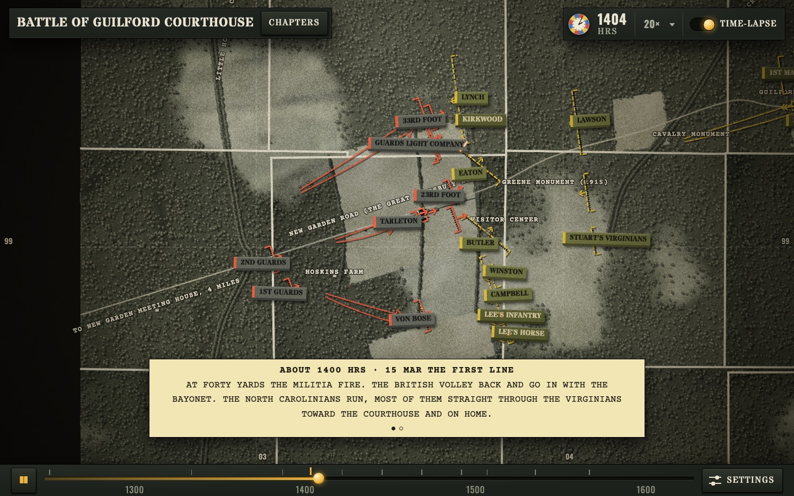

The Civil War skin (`civil-war`) is a topographical engineer's survey after Hotchkiss and Bachelder: brown contours in
feet with every fifth heavier and figured, woods edged in scallops, red-ochre roads, Prussian-blue streams widening
downstream, worm fences, and a black square for each named building. A regiment is a block in its side's colour ruled
into companies, its front rank heavier, under a small flag (a swallow-tailed guidon for cavalry); a battery is a row of
guns; small crosses mark the fallen. A meridian arrow and a scale of feet sit in a free corner. Colour a Civil War
battle's sides Union blue and Confederate red in `battle.json`, as Bachelder did. Night falls blue-grey and a lantern
lights the sheet. The panels are ruled linen and the bar and clock blue cloth with a gilt rule, the dial a gilt-rimmed watch, as on the start screen, whose
backdrop is drawn from the same ground. See `docs/adr/0006-civil-war-skin.md`.

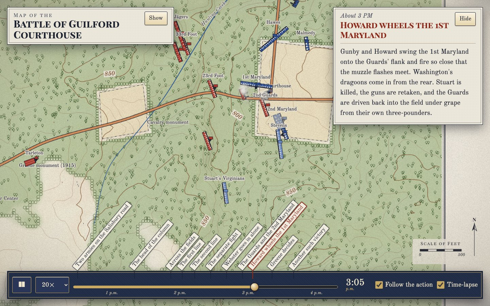

The War of 1812 skin (`war-of-1812`) is a coastal chart with a blue paper back, as Blunt and the Admiralty sold them:
navy ink on cream, the land washed yellow along its shore, white water lined inside the coast and figured with
soundings in fathoms, hills as short hachures, woods as the chart's tree sign, rhumb lines fanning from a sixteen-point
rose, and a graduated border with the blue backing beyond. A unit is a block in its side's colour under a navy rule
with a pennant on its front; a pecked line marks where it has been. Under a `?theme=` preview the first side is blue
and the last red. The clock's dial is a chronometer, white with navy hands in a brass ring, and the bar and clock
sit on the chart's blue backing. The start screen draws the war's backdrop from the same ground. See
`docs/adr/0007-war-of-1812-skin.md`.

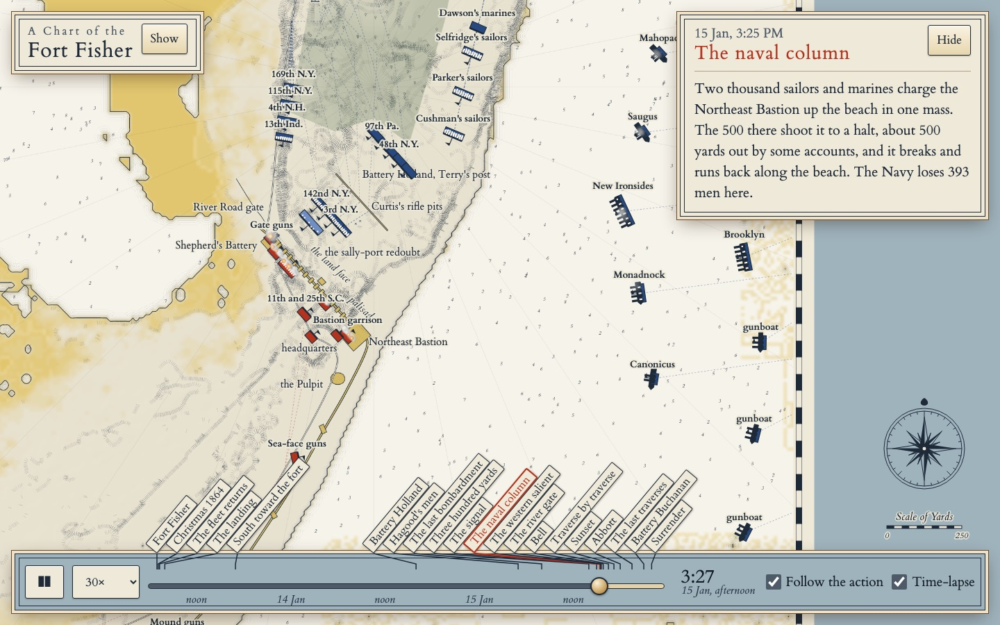

The First World War skin (`ww1`) is a 1:10,000 trench map, as the Ordnance Survey and the AEF printed them: cream
paper, brown contours with every fourth heavier, woods as ring-on-stalk tree signs, and a squared grid of 1000-yard
squares numbered 1 to 36 inside lettered 6000-yard squares. Every trench and work is red, stepped into fire bays and
traverses, with wire as crosses before it. A unit is a block in its side's colour under an ink rule; a dashed line
marks where it has been. A "SCALE 1:10,000" bar in yards sits in a free corner, the clock reads as the war diaries
wrote it (2.15 p.m.) beside a trench watch with luminous hands, and at night a star shell drifts over the field. Under a `?theme=` preview the first side is
blue and the last red. The start screen draws the war's backdrop from the same ground, on Yorktown's siege works. See
`docs/adr/0008-first-world-war-skin.md`.

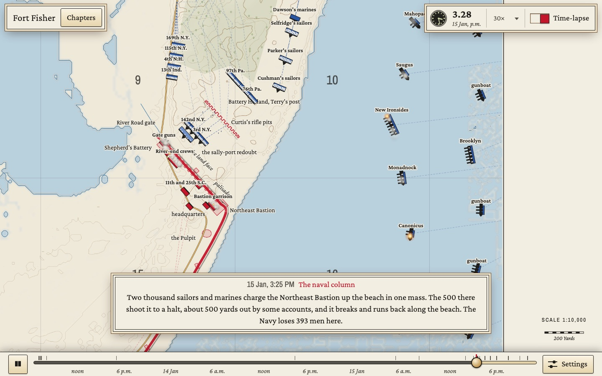

`,bench` on a link measures the cost of a frame; `bash tools/bench.sh 'guilford@14:02,play,warp'` runs it in headless
Chrome and prints milliseconds per frame and the time the layer took to build.

**Time-lapse** (on by default, key `t`) hurries through stretches where nothing moves: the clock runs
at the battle's `lapse` rate until 90 seconds before the next movement, appearance or fight. A siege
bombardment does not count as movement, so Yorktown's days of gunnery pass in seconds.

## Add a battle

1. Add `battles/<id>/battle.json` and list it in `battles/index.json` with `id`, `name`, `date`
   (ISO) and `war`; `npm run check` keeps the list in date order, and the start screen groups it by war. Each existing battle is
   generated by its `make.py`, which is the easier way to author a timeline: edit it, run it, check.
2. Fetch terrain: `python3 tools/fetch_terrain.py LAT LON HALF_METRES COLS battles/<id>/terrain.json`.
   HALF_METRES must be half of `extent` in battle.json. US battlefields come from USGS 3DEP at 10 m.
   Elsewhere add `--copernicus` for the Copernicus GLO-30 surface model at 30 m, and put its licence
   credit (the `source` in terrain.json) in the battle's `sources`.
3. `npm run check`.

### battle.json

Coordinates are metres from `origin` (the lat/lon at the map centre): x east, y north. Headings are
compass degrees. Times are the local clock, `HH:MM`, or `YYYY-MM-DD HH:MM` for a battle that runs more
than a day; one battle uses one form throughout.

| field | meaning |
|---|---|
| `extent` | map width and height in metres, centred on `origin` |
| `theme` | the skin (`themes.js`): `revolution`, `war-of-1812`, `civil-war`, `ww1` or `ww2`; by default the skin of the war the battle's date falls in, and `revolution` outside every war |
| `start`, `end`, `sunrise`, `sunset` | battle clock; the map is tinted before sunrise and, if `sunset` is given, every night |
| `speed`, `lapse` | default playback multiplier, and the multiplier for quiet stretches under time-lapse (default `speed × 6`) |
| `water` | elevation in metres at or below which the DEM is drawn as water (rivers are flattened to about 0) |
| `menPerDot` | men per drawn dot (5 for a small battle, 10 or 20 for a large one) |
| `smoke` | scales the smoke from firing units on top of the skin's own amount (default 1; 0 for none); muzzle flashes are unchanged |
| `sides` | `{ id: { name, color, light, dark, wax?, tracer? } }`; `wax` and `tracer` (`[r, g, b]`) are a side's chinagraph and tracer colours in the `ww2` skin |
| `units[]` | `id, side, name, short?, commander, type, strength, guns?, loose?, ranks?, keys[]`; `short` is the map label; `loose` keeps a unit in open order; `ranks` defaults to 2 |
| `keys[]` | `{ t, x, y, h, state, strength }`; omitted fields carry forward from the previous key |
| `events[]` | `{ t, title, text, at: [x, y], view, speed, when }` captions; the story gives `t` to the nearest hour ("About 3 PM") unless `when` holds a time the sources record; `at` and `view` (metres across) steer the auto-camera; `speed` sets the playback rate for that chapter while Follow is on (each chapter resets to the battle's `speed`) |
| `features[]` | `{ type: road|creek|fence|works|trench, name, pts }` lines, `{ type: redoubt|battery|ship|camp|water, poly }` polygons (`water` draws a shoreline the modern ground no longer shows), `{ type: smoke, at, rate, spread }` a burning town or ship, `{ type: airstrike, at, spread, h, from, until }` aircraft bombing round `at` (radius `spread` m, flying on heading `h`), cosmetic like smoke, `{ type: drop, kind: para|glider, zone, h, craft, units, from, until }` an airborne landing (`zone` is the polygon where the men came down, `h` the run-in heading, `craft` the aircraft or gliders, `from` and `until` the first and last man or glider down; each of `units` must stay `hidden` until its first visible key at or after `until`, where it has formed, and is in one drop only; the skin's `air` hook draws the transports, canopies or gliders and the men walking in; [ADR-0011](docs/adr/0011-airborne-drops.md), [ADR-0013](docs/adr/0013-gliders-at-the-transports-pace.md)), or `{ name, at, rot }` labels; `from` and `until` show a feature only between those times, which is how siege lines get dug |
| `tints[]` | `{ from, until, color }` weather washes over the whole map, such as a snowstorm, fading in and out over ten minutes |
| `trees` | `density` in trees per square metre; `clear` is a list of polygons left bare, such as a summit |
| `fields` | polygons of cleared farmland, tinted lighter and kept free of trees |
| `sources[]` | shown in the Sources dialog |

Unit types: `infantry`, `light_infantry`, `militia`, `riflemen`, `cavalry`, `artillery`, `armor`.
An `armor` unit's `strength` counts vehicles, not men: one dot per vehicle whatever `menPerDot` is, about
50 m apart in line and 30 m apart in column, and a casualty marker for each vehicle lost.
States: `hidden`, `column`, `line`, `skirmish`, `firing`, `charge`, `retreat`, `rout`, `surrender`.
A `firing` or `skirmish` state makes the unit smoke; a falling `strength` leaves casualty markers.
Positions between keys are straight-line interpolation, so add keys where a unit follows a road.

## Licence

The code and Field Glass's own text and images are under the [MIT licence](LICENSE), copyright Dave Vause.
Terrain, map data and fonts from others keep their own licences, and the Field Glass, Vauseware and Vause
Consulting names and icons are trademarks, not MIT: see [THIRD_PARTY.md](THIRD_PARTY.md). Contributions are
welcome under the DCO in [CONTRIBUTING.md](CONTRIBUTING.md); please follow the
[Code of Conduct](CODE_OF_CONDUCT.md) and report security problems as [SECURITY.md](SECURITY.md) describes.
